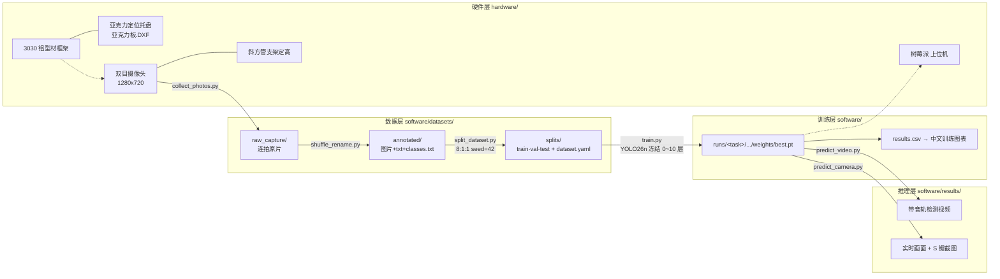

<div align="center">

# 视觉检测台 / Vision Inspection Station

**一台「铝型材 + 亚克力托盘 + 双目摄像头 + 树莓派 + YOLO」的自制零件视觉检测台 —— 项目起源档案**

从 0 到 1：机械建模 → 打光拍照 → 数据标注 → 迁移学习 → 实时推理，全链路自建、全文件开源。


</div>

---

## 目录

- [1. 项目起源](#1-项目起源)
- [2. 整体架构](#2-整体架构)
- [3. 仓库目录结构（本次重新分类的结果）](#3-仓库目录结构本次重新分类的结果)
- [4. 快速开始](#4-快速开始)
- [5. 数据集](#5-数据集)
- [6. 训练：迁移学习 + Backbone 冻结](#6-训练迁移学习--backbone-冻结)
- [7. 训练结果](#7-训练结果)
- [8. 推理：视频与摄像头实时检测](#8-推理视频与摄像头实时检测)
- [9. 硬件与机械结构](#9-硬件与机械结构)
- [10. 本次重构做了什么 / 踩过的坑](#10-本次重构做了什么--踩过的坑)
- [11. 后续路线](#11-后续路线)
- [12. 开源与许可](#12-开源与许可)
- [13. 致谢](#13-致谢)

---

## 1. 项目起源

这个项目的起点是一个很小的痛点：**装配时零件混在一盒里，靠人眼看"这把里还有没有角码、轴承对不对数"极易出错，而且没有可留存的证据**。

于是有了这台检测台，约束条件全部来自"低成本 + 可复现"：

| 约束 | 落地方式 |
| --- | --- |
| 结构不要精密加工 | 3030 欧标铝型材 + 直角支架拼装，全部 SolidWorks 自建模型 |
| 拍照位置要每次一致 | 亚克力托盘开格，零件放进固定槽位；顶部斜方管固定相机高度 |
| 算力要便宜 | 树莓派做上位机建模参考，训练在带 CUDA 的 PC 上完成，推理脚本 CPU/GPU 自适应 |
| 不要花钱买标注服务 | 自写 `collect_photos.py` 连拍采集 + `shuffle_rename.py` 打乱去序 + YOLO txt 标注 |
| 小样本也要能用 | YOLO26n 迁移学习，冻结 Backbone 第 0~10 层，只训 Neck + Detect（105 张图训出 mAP@0.5 = 0.995） |
| 每一步都要能重跑 | 采集 / 整理 / 划分 / 训练 / 推理 6 个脚本，路径全部由 `software/scripts/paths.py` 统一推导 |

**它不是一个"调包 demo"，而是一份从零开始的档案**：原始 SLDASM 装配体、DXF 加工图、105 张已标注原图、两次完整训练产物（含曲线与权重）、两个演示视频，都在仓库里。

### 版本演进

| 版本 | 任务 | 类别 | 说明 |
| --- | --- | --- | --- |
| v0.1 | 螺丝 / 螺母 | `luosi` `luomu` | 首次跑通「拍照 → 标注 → 训练 → 视频检测」全链路，mAP@0.5:0.95 = 0.627 |
| v0.2 | 角码 / 轴承 | `jiaoma` `zhoucheng` | 换零件 + 加严训练（282 epoch），mAP@0.5:0.95 提升到 **0.801**，定位框更贴合 |

详见 [`CHANGELOG.md`](CHANGELOG.md)。

---

## 2. 整体架构



流水线一句话：**拍照 → 打乱改名 → 标注 → 划分 → 训练 → 视频/实时推理**，6 个脚本对应 6 个阶段，一个都不能少。

---

## 3. 仓库目录结构（本次重新分类的结果）

原始文件夹是「上游源码包 + 自己的脚本 + 数据 + 机械图」全部堆在一起的状态；现在按**职责**分成四大块（机械 / 软件 / 文档 / 工具），数据与产物按**流水线阶段**分级。

```text
视觉检测台/                        # 建议 GitHub 仓库名：vision-inspection-station
├── README.md                      # 本文件：项目起源总说明
├── CHANGELOG.md                   # v0.1 → v0.2 迭代记录
├── LICENSE                        # AGPL-3.0（继承上游 Ultralytics）
├── requirements.txt               # Python 依赖
├── .gitignore / .gitattributes    # 仓库瘦身与换行/LFS 约定
│
├── docs/                          # 文档与配图
│   ├── PIPELINE.md                # 端到端流水线手册（命令级）
│   ├── DATASET.md                 # 数据集规范、标注格式、统计口径
│   ├── BOM.md                     # 硬件物料清单 + 加工件说明
│   ├── MIGRATION.md               # 目录重排映射表 + 回滚方法
│   └── assets/                    # README 引用图（训练曲线/混淆矩阵/检测样例）
│
├── hardware/                      # 机械设计（SolidWorks 原生文件）
│   ├── 视觉检测台.SLDASM           # 总装配体
│   ├── 零件/                       # 10 个 .SLDPRT 零件（与装配体保持同级相对路径）
│   │   ├── 欧标3030_250/340/400mm.SLDPRT   # 立柱与横梁
│   │   ├── 斜方管.SLDPRT                    # 相机臂（倾斜定高）
│   │   ├── 直角支架.SLDPRT / Aluminum extrusion corner bracket for 2020.SLDPRT
│   │   ├── 亚克力板.SLDPRT                  # 定位托盘（3D）
│   │   ├── 双目摄像头建模.SLDPRT            # 相机
│   │   ├── 树莓派主机建模.SLDPRT            # 上位机
│   │   └── 外壳.SLDPRT                      # 电控/接线外壳
│   └── 亚克力板.DXF                # 激光切割加工图
│
└── software/                      # 全部代码与数据
    ├── scripts/                   # ★ 6 个流水线脚本 + 1 个路径模块
    │   ├── paths.py                # 唯一的路径/设备/权重解析入口（消灭绝对路径）
    │   ├── collect_photos.py       # ① 摄像头连拍采集（鼠标点击一次拍 5 张）
    │   ├── shuffle_rename.py       # ② 随机打乱并重命名为 1,2,3...（两阶段改名防覆盖）
    │   ├── split_dataset.py        # ③ 校验标签 + 8:1:1 划分 + 生成 dataset.yaml
    │   ├── train.py                # ④ 迁移学习训练 + 中文训练图表
    │   ├── predict_video.py        # ⑤ 视频逐帧检测 + 原音轨合并 + 同步播放
    │   └── predict_camera.py       # ⑥ 摄像头实时检测 + FPS + S 键截图
    ├── configs/                   # 可提交的配置快照
    │   ├── dataset.example.yaml    # 数据集配置模板（省略 path，可移植）
    │   ├── args.luosi_luomu.yaml   # v0.1 训练完整超参快照
    │   └── args.jiaoma_zhoucheng.yaml # v0.2 训练完整超参快照
    ├── datasets/
    │   ├── annotated/             # ★ 真值数据：105 张 .jpg + 105 张 .txt + classes.txt（唯一必须备份的一层）
    │   ├── splits/                # 派生：train(84)/val(10)/test(11) + dataset.yaml
    │   └── raw_capture/           # 派生：连拍与打乱改名输出（图片与 annotated 重复，默认不入库）
    ├── models/
    │   └── base/yolo26n.pt        # 预训练基座权重（5.4 MB）
    ├── runs/                      # 训练产物：图表 + results.csv + best/last.pt
    │   ├── luosi_luomu/           # v0.1
    │   └── jiaoma_zhoucheng/      # v0.2
    ├── samples/video/             # 演示素材 1.mp4 / 2.mp4
    ├── results/                   # 推理输出目录（脚本自动创建）
    └── vendor/ultralytics/        # 上游 Ultralytics 8.4.175 源码快照（AGPL-3.0）
```

> 说明：`tools/reorganize.ps1` 是本次重排用的脚本，`tools/move_log.csv` 是每一步的迁移日志，可用 `-Undo` 一键回滚到原始结构（详见 [docs/MIGRATION.md](docs/MIGRATION.md)）。

---

## 4. 快速开始

### 4.1 环境

```bash
# Python 3.8+（本仓库实测使用 3.10）
python -m venv .venv
.venv\Scripts\activate            # Windows；Linux/macOS 用 source .venv/bin/activate
pip install -r requirements.txt
```

依赖核心：`torch` / `torchvision`（按官网选择 CUDA 版本）、`ultralytics`、`opencv-python`、`matplotlib`、`pandas`、`pyyaml`、`imageio-ffmpeg`、`pygame`。

> **两种导入方式**：`paths.bootstrap_ultralytics()` 会**优先**把 `software/vendor/ultralytics` 加入 `sys.path`（保证复现与上游源码一致）；若你想用 pip 版本，把该目录改名或删掉即可自动回退。

### 4.2 六步流水线

```bash
cd software/scripts

python collect_photos.py  --dir ../datasets/raw_capture --camera 1 --count 5   # ① 采集
python shuffle_rename.py  --dir ../datasets/raw_capture --seed 42              # ② 打乱改名
#   （此步后把图片移到 datasets/annotated/ 并用标注工具画框）
python split_dataset.py                                                    # ③ 校验 + 划分
python train.py                                                            # ④ 训练（数小时/数分钟看卡）
python predict_video.py                                                    # ⑤ 视频检测
python predict_camera.py                                                   # ⑥ 实时检测
```

### 4.3 环境变量（可选，无需改代码）

| 变量 | 作用 | 默认 |
| --- | --- | --- |
| `VISIS_TASK` | 当前任务名，决定 `runs/<task>/...` 与默认加载权重 | `jiaoma_zhoucheng` |
| `VISIS_BASE_MODEL` | 基座权重路径 | `software/models/base/yolo26n.pt` |
| `VISIS_DATA_YAML` | 数据集配置 | `software/datasets/splits/dataset.yaml` |
| `VISIS_DEVICE` | 强制设备 | 自动探测（有 CUDA 用 `0`，否则 `cpu`） |

```bash
VISIS_TASK=luosi_luomu python train.py       # 复现 v0.1
```

### 4.4 发布到 GitHub

本仓库当前**还没有 `.git`**（保持原始文件夹状态，不擅自提交）。确认结构无误后：

```bash
cd 视觉检测台
git init -b main
git add README.md CHANGELOG.md LICENSE requirements.txt .gitignore .gitattributes docs hardware software tools
git commit -m "chore: 视觉检测台项目起源档案（目录重排 + 可移植化 + 全链路文档）"
git remote add origin https://github.com/<你的账号>/vision-inspection-station.git
git push -u origin main
```

体积实测（本文件夹合计 **90.5 MB / 1681 个文件**，GitHub 单文件上限 100 MB、仓库超 5 GB 会被拒绝推送）：

| 目录 | 体积 | 文件数 | 属性 |
| --- | --- | --- | --- |
| `software/datasets/annotated/` | 13.2 MB | 211 | ★ 真值数据（105 图 + 105 标签 + classes.txt），**必须提交** |
| `software/datasets/splits/` | 13.2 MB | 213 | 派生，可由 ③ 重建（内含 2 个 `labels.cache`，已 `.gitignore` 排除） |
| `software/datasets/raw_capture/` | 13.2 MB | 105 | 与 annotated 重复，已在 `.gitignore` 排除 |
| `software/runs/` | 25.7 MB | 48 | 图表 + csv + `best/last.pt`（4 个 `.pt` 合计 20.8 MB） |
| `software/vendor/` | 10.1 MB | 1044 | 上游快照（其中 `docs/` 就占 5 MB） |
| `software/models/base/` + `samples/` | 5.3 + 4.6 MB | 3 | 基座权重 + 演示视频 |
| `hardware/` | 2.4 MB | 12 | SolidWorks 原生文件 |
| `docs/assets/` | 2.7 MB | 23 | README 配图 |

按需要的"仓库画像"三选一：

- **完整可复现（~90 MB）**：保持现状提交，把 `*.pt` / `*.mp4` 走 Git LFS（取消 `.gitattributes` 末段注释后 `git lfs install`）。注意 LFS 免费额度仅 1 GB 存储 / 1 GB 月带宽。
- **代码 + 数据 + 权重（~70 MB）**：在 `.gitignore` 追加 `software/vendor/` 与 `software/runs/**/weights/last.pt`（后者已默认排除），依赖改用 `pip install ultralytics==8.4.175`。
- **精简起源档案（~35 MB）**：再追加 `software/datasets/splits/`、`software/samples/`，只留脚本 + 文档 + 机械图 + annotated + `best.pt` + 图表；别人 clone 后跑 ③④ 就能完整重建。


---

## 5. 数据集

### 5.1 类别

| ID | 名称（`classes.txt`） | 说明 | 标注框数（v0.2） |
| --- | --- | --- | --- |
| 0 | `jiaoma` | 角码 | 170 |
| 1 | `zhoucheng` | 轴承 | 130 |
|  | **合计** | 105 张图 | **300** |

### 5.2 采集与规格

- 尺寸 **1280 × 720**，JPEG 质量 95，俯视拍摄，零件放在亚克力定位托盘内（保证位置与光照可复现）。
- 采集用 `collect_photos.py`：一次点击连拍 5 张、间隔 0.3 s，形成同一场景的多角度微变化样本。
- `shuffle_rename.py` 随机打乱后改名为 `1.jpg, 2.jpg, ...`，**目的是让文件名不暴露拍摄顺序**（避免"同一批拍的图恰好被切成 train/val"这种假独立性）。

### 5.3 标注格式

YOLO 目标检测 txt 格式，一行一个目标：

```text
<class_id> <x_center> <y_center> <width> <height>      # 全部为相对宽高的归一化值 0~1
```

示例（`datasets/annotated/1.txt`）：

```text
1 0.459882 0.128378 0.052787 0.090090
0 0.316301 0.124625 0.061233 0.112613
0 0.399177 0.134009 0.068623 0.101351
```

`split_dataset.py` 在划分前做**强制校验**，任一问题即中止且不写入：5 字段、数值可解析、类别 ID 在范围内、坐标在 0~1、宽高 > 0、同名图片不重复、缺标签直接报错（`REQUIRE_LABELS = True`，防止图片被当成背景图）。

### 5.4 划分

| 集合 | 图片数 | 比例 | 路径 |
| --- | --- | --- | --- |
| train | 84 | 0.8 | `datasets/splits/train/images` + `labels` |
| val | 10 | 0.1 | `datasets/splits/val/...` |
| test | 11 | 0.1 | `datasets/splits/test/...` |

随机种子固定 `RANDOM_SEED = 42`，比例之和强校验为 1，且三个集合均保证非空。

完整规范见 [docs/DATASET.md](docs/DATASET.md)。

---

## 6. 训练：迁移学习 + Backbone 冻结

### 6.1 模型

**YOLO26n**（Ultralytics 8.4.175，`software/vendor/ultralytics/ultralytics/cfg/models/26/yolo26.yaml`）：

| 指标 | 值 |
| --- | --- |
| 参数量 | 2,572,280 |
| 计算量 | 6.1 GFLOPs |
| Backbone | 第 0~10 层（Conv/C3k2/SPPF/**C2PSA**） |
| Neck + Detect | 第 11~23 层（P3/P4/P5 三尺度，`Detect` 在第 23 层） |

### 6.2 冻结策略（本项目关键设计）

105 张图不足以从零训练，也容易破坏 COCO 预训练特征。因此：

```python
FREEZE_BACKBONE = True
BACKBONE_END_INDEX = 10        # 冻结 0~10，训练 11~23
```

`configure_backbone_freeze()` 做三件事：**打印逐层结构 → 先全部解冻再冻结 0~10 → 训练前二次校验冻结状态**（任一层未完全冻结直接抛错），并统计冻结 / 可训练参数量。这样做的收益：小样本下不灾难性遗忘，训练时间显著缩短，显存占用更低。

### 6.3 超参

| 参数 | 值 | 参数 | 值 |
| --- | --- | --- | --- |
| 起点权重 | `yolo26n.pt`（`pretrained=True`） | epochs | 300（`patience=100` 早停） |
| optimizer | AdamW | imgsz | 640 |
| lr0 / lrf | 0.001 / 0.01 | batch | 4 |
| cos_lr | True | workers | 0 |
| momentum | 0.937 | AMP | True |
| weight_decay | 0.0005 | seed / deterministic | 0 / True |
| warmup | epochs 3.0 · momentum 0.8 · bias_lr 0.1 | device | 自动 CUDA/CPU |

> 注：**不向 AdamW 传 `betas`**。当前 Ultralytics 版本会因该参数报错，代码里留了注释说明。
> 完整参数快照（可直接 diff）：`software/configs/args.<task>.yaml`。

### 6.4 中文训练图表

`make_chinese_plots()` 在读 `results.csv` 后输出 5 张中文图（微软雅黑/黑体自动回退、`axes.unicode_minus=False` 防负号方框）：训练损失、验证损失、精确率与召回率、mAP 曲线、学习率曲线。

---

## 7. 训练结果

### 7.1 指标对比（验证集最优值）

| 版本 / 任务 | 实际 epoch | 训练时长 | Precision | Recall | mAP@0.5 | mAP@0.5:0.95 |
| --- | --- | --- | --- | --- | --- | --- |
| v0.1 `luosi_luomu` | 185 | 541.5 s | 0.9964 | **1.000** | 0.995 | 0.627 |
| v0.2 `jiaoma_zhoucheng` | 282 | 846.4 s | **1.000** | **1.000** | 0.995 | **0.801** |

解读：

- **Recall = 1.0**：验证集里没有漏检——对"数零件/找零件"这类检测任务，漏检比误检更致命，这条正好命中需求。
- **mAP@0.5 = 0.995**：框位置已经够用；**mAP@0.5:0.95 从 0.627 → 0.801**，说明 v0.2 的框贴得更紧（IoU 要求更严的那一段显著改善）。
- 训练成本极低：84 张训练图、282 epoch 只花 **846 秒**（约 3 s/epoch）。

### 7.2 曲线与矩阵

| v0.2 训练全景 | v0.2 混淆矩阵（归一化） | v0.2 PR 曲线 |
| --- | --- | --- |
|  |  |  |

| v0.2 中文损失曲线 | v0.2 中文 mAP 曲线 | v0.2 类别分布 |
| --- | --- | --- |
|  |  |  |

| v0.2 真值标注 batch0 | v0.2 预测结果 batch0 | 数据集样例 |
| --- | --- | --- |
|  |  |  |

| v0.1 训练全景 | v0.1 PR 曲线 | v0.1 预测样例 |
| --- | --- | --- |
|  |  |  |

### 7.3 复现方式

```bash
cd software/scripts
VISIS_TASK=jiaoma_zhoucheng python train.py
# 产物：software/runs/jiaoma_zhoucheng/runs/26train/exp/{weights/best.pt, results.csv, 中文训练图表/}
```

### 7.4 运行环境（请自行核对后填写）

| 项 | 值 |
| --- | --- |
| OS | Windows 10/11（实测）+ Linux 兼容 |
| Python | 3.10（由 `__pycache__/*.cpython-310.pyc` 证实） |
| GPU | `[待填写：你的显卡型号 / CUDA 版本]` |
| CPU | `[待填写]` |
| 上位机 | 树莓派（`hardware/零件/树莓派主机建模.SLDPRT`） |
| 相机 | 双目摄像头 1280×720（`双目摄像头建模.SLDPRT`） |

---

## 8. 推理：视频与摄像头实时检测

### 8.1 视频检测 `predict_video.py`

逐帧检测 → 写无声视频 → 用 FFmpeg（`imageio_ffmpeg` 自动定位）把**原音轨**合回去，播放时以音频时钟调度画面，进度每 30 帧打印一次。

输出：`software/results/video/exp/detected_silent.mp4`、`detected_with_audio.mp4`。
关键参数：`CONF = 0.25`、`IMGSZ = 640`、`SHOW_LABELS/SHOW_CONF = True`；无音轨时自动降级为无声检测而不报错。

### 8.2 实时检测 `predict_camera.py`

```text
摄像头 1280×720 → YOLO 推理 → results[0].plot().copy() → 叠加 FPS → 显示
按键：Q / ESC 退出    S 截图保存（detection_YYYYmmdd_HHMMSS.jpg）
截图目录：software/results/camera/
```

两处实测细节：

- `cv2.VideoCapture(CAMERA_ID, cv2.CAP_DSHOW)` 失败时**自动退回默认后端**再试一次；
- `results[0].plot()` 的返回数组**必须 `.copy()`**，否则 `cv2.putText` 在部分版本会因数组不可写而报错（代码注释里标了"关键修复"）。

### 8.3 权重解析顺序

`paths.resolve_weights()`：**`models/trained/<task>.pt` → `runs/<task>/.../weights/best.pt` → `models/base/yolo26n.pt`**。
因此发布权重只需把 `best.pt` 拷成 `software/models/trained/jiaoma_zhoucheng.pt`，脚本自动加载，无需改代码。

> 说明：v0.1/v0.2 时期的推理脚本指向的是**基座 `yolo26n.pt`**（COCO 通用类别），并非自训练权重——本次重构已统一改为"优先加载已训练权重"，这是行为修正，结果图会与此前不同。

---

## 9. 硬件与机械结构

- 装配体：`hardware/视觉检测台.SLDASM`（SolidWorks，零件相对路径已保持为同级 `零件/`，直接打开即可，无需重链接）
- 框架：3030 欧标铝型材，三根下料长度 **250 / 340 / 400 mm**，直角支架 + 2020 角码连接
- 相机臂：`斜方管.SLDPRT`（定高 + 俯角，保证成像距离一致）
- 成像对象定位：`亚克力板.SLDPRT` + **`亚克力板.DXF`（可直接发激光切割）**
- 电控/宿主：`树莓派主机建模.SLDPRT`、`外壳.SLDPRT`

完整下料尺寸、紧固件数量、加工注意事项见 [docs/BOM.md](docs/BOM.md)。

> 实物照片与装配渲染图待补充：放到 `docs/assets/hardware-*.jpg` 后在本节插入即可。

---

## 10. 本次重构做了什么 / 踩过的坑

原始目录 = `ultralytics-main/`（上游包）+ 自己的 6 个脚本混在上包根目录 + 数据/权重/视频散在里层 + 机械文件在上一层。重构与修复清单：

| # | 问题（重构前） | 处理（重构后） |
| --- | --- | --- |
| 1 | 上游源码、自写脚本、数据、产物、文档混在一个 `ultralytics-main/` 里 | 拆成 `software/{scripts,configs,datasets,models,runs,samples,results,vendor}` + `hardware/` + `docs/` + `tools/` |
| 2 | 脚本硬编码 `D:\Windows_Desktop\ultralytics-main\...`，**该路径早已失效**（实际在 `视觉检测台\ultralytics-main\`） | 全部改由 `paths.py` 从 `__file__` 推导；盘符无关，clone 到任何位置都能跑 |
| 3 | `dataset.yaml` 写死 `path: D:/Windows_Desktop/ultralytics-main/output`（指向已不存在的目录） | 省略 `path`，由 dataset.yaml 所在目录推导；`split_dataset.py` 新增 `WRITE_ABSOLUTE_PATH = False` |
| 4 | `photos.py` / `ram.py` / `real.py` / `predict.py` 文件名无法望文生义 | 更名 `collect_photos.py` / `shuffle_rename.py` / `predict_camera.py` / `predict_video.py`，与 `split_dataset.py`、`train.py` 一起加 ①~⑥ 序号 |
| 5 | `yolo26n.pt` 在 `ultralytics-main/` 与 `weights/` 各存一份（SHA256 相同） | 去重，保留 `software/models/base/yolo26n.pt` |
| 6 | 153 个 `.pyc` / 25 个 `__pycache__`（2.1 MB）将被提交进 Git | 删除，并在 `.gitignore` 中永久排除 |
| 7 | 空的 `camera_results/` 目录 | 删除；推理输出统一 `software/results/`，由脚本自动创建 |
| 8 | 推理默认用基座权重而非自训练权重 | `resolve_weights()` 优先已训练权重（见 §8.3） |
| 9 | 训练产物散在深层 `runs/<task>/runs/26train/exp` | 保留 Ultralytics 原生结构（不破坏 resume），仅在 `configs/` 存 `args.*.yaml` 快照，README 引用图抽到 `docs/assets/` |

全程**只移动、不删除数据**（仅去重与清缓存），且每步写入 `tools/move_log.csv`；回滚：

```powershell
powershell -ExecutionPolicy Bypass -File tools\reorganize.ps1 -Undo
```

---

## 11. 后续路线

- [ ] 补齐实物照片 / 装配渲染图，并把 `docs/BOM.md` 的紧固件数量核对到实物
- [ ] 扩充数据集到 ≥500 张（当前 105 张），并把 test 集扩到覆盖"混料 / 缺料 / 反装"三种异常
- [ ] 类别从 2 类扩到全零件清单（螺丝 / 螺母 / 角码 / 轴承 …），或改为多模型 + 任务路由
- [ ] 加计数与缺件判定逻辑（检测框数量 → 装配 BOM 校验），输出 CSV/PDF 质检单
- [ ] 导出 ONNX / TensorRT 并在树莓派上做 NPU/INT8 部署，打通"拍照 → 判定 → 不良报警"闭环
- [ ] 引入主动学习：把 `predict_camera.py` 的 S 键截图直接回流到 `datasets/annotated/`
- [ ] 测试：给 `paths.py`、`split_dataset.py` 的校验逻辑加 pytest 单测
- [ ] CI：GitHub Actions 跑 `python -m py_compile` + `split_dataset.py --check` 干跑

---

## 12. 开源与许可

- **本仓库自写部分**（`software/scripts/`、`docs/`、`tools/`）与 **`software/vendor/ultralytics/`（AGPL-3.0）** 一同分发，因此根 `LICENSE` 使用 **AGPL-3.0**（见 `LICENSE`）。
- 若你选择**不携带**上游源码副本、改为 `pip install ultralytics` 使用，则仅你自己的代码在仓库内，可单独为自有代码选择许可 —— 请在发布前确认这一点。
- 训练基座权重 `yolo26n.pt` 由 Ultralytics 提供，商用需按其官方条款处理。

## 13. 致谢

- [Ultralytics](https://github.com/ultralytics/ultralytics) —— YOLO26 与整套训练/推理框架。
- SolidWorks 自带的铝型材与摄像头建模素材习惯，以及 3030 欧标型材规格。
- 每一个把"算法定位框往左挪 2 个像素"重复到第 20 遍的夜晚。

---

<details>
<summary><b>English summary</b></summary>

**Vision Inspection Station** is a self-built, low-cost parts inspection bench: a 3030 European-standard aluminum extrusion frame with an acrylic locator tray (laser-cut DXF included), a fixed-height stereo camera on a slanted arm, and a Raspberry Pi as host. The vision side is a full in-house pipeline — custom burst-capture script, order-shuffling rename script, label-validating 8:1:1 dataset splitter (seed 42), YOLO26n transfer-learning script that **freezes backbone layers 0-10 and trains only neck + detect (11-23)** with AdamW + cosine LR, and two inference scripts (per-frame video detection with original-audio muxing; real-time camera detection with FPS overlay and hotkey snapshots).

On a 105-image / 300-box dataset the model reaches **Precision 1.000, Recall 1.000, mAP@0.5 0.995, mAP@0.5:0.95 0.801** (282 epochs, 846 s on 84 training images), up from mAP@0.5:0.95 = 0.627 in v0.1 (screws/nuts). The folder was re-classified into `hardware/` (SolidWorks assembly + parts + DXF), `software/{scripts,configs,datasets,models,runs,samples,vendor}`, `docs/` and `tools/`, with all hard-coded absolute paths replaced by a single `paths.py` module so the repo runs from any clone location.

</details>
